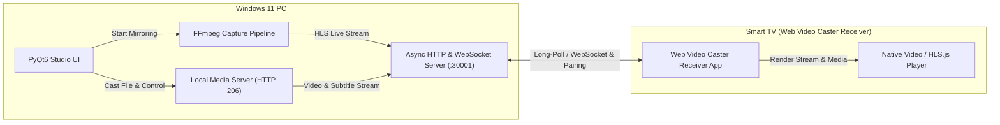

# 📺 Web Video Caster — Windows 11 Screen & Media Caster

<p align="center">
  <b><a href="README.md">🇺🇸 English</a></b> | <b><a href="README.tr.md">🇹🇷 Türkçe</a></b>
</p>

<p align="center">
  
  
  
  
  
</p>

> A modern Windows 11 desktop application that emulates a native Web Video Caster sender device to **mirror your desktop screen (with synchronized system audio)** and **cast local video/music files with subtitles** directly to the **Web Video Caster Receiver** app on your Smart TV (Android TV, Google TV, Fire TV, LG webOS, Samsung Tizen, Vestel/TiVo/Vewd).

---

## ✨ Features

- **🖥️ Ultra-Low Latency Screen Mirroring:**
  - Captures your Windows desktop with hardware encoder acceleration (**NVIDIA NVENC, Intel QuickSync, AMD AMF, or CPU libx264**).
  - Streams chunked local HLS (HTTP Live Streaming) directly to the TV player.
  - Supports 1080p Full HD, 720p HD, 2K QHD, and 4K Ultra HD at 30 FPS, 60 FPS, or 24 FPS.
- **🔊 Synchronized Desktop Audio Loopback:**
  - Captures and streams all PC system audio in sync with the desktop display.
- **🎬 Local Media Casting & Remote Controller:**
  - Streams local video files (`.mp4`, `.mkv`, `.avi`, `.mov`, `.webm`, `.ts`) and audio tracks (`.mp3`, `.flac`, `.wav`, `.aac`) directly to your TV.
  - **HTTP 206 Partial Content (Byte Range Requests):** Instant seeking and scrubbing without waiting for files to download.
  - **Interactive Remote Controls:** Click-to-seek progress bar, live scrubbing preview, fast skip buttons (`⏪ -10s`, `⏩ +10s`), volume slider, and mute toggle.
  - **Automatic Subtitles (.srt / .vtt):** Detects matching subtitles in the same folder, converts them to WebVTT on the fly, and displays them on the TV.
- **🔗 Smart TV Pairing & Full Protocol Emulation:**
  - Implements the native Web Video Caster Smart TV long-polling protocol (`/web-receiver-io/*`) and browser WebSocket interface (`/ws`).
  - Generates Base36 pairing codes (e.g. `7U`) for instantaneous, one-touch pairing from the TV.
- **🌐 Bilingual Internationalization (TR / EN):**
  - Switch the entire user interface between English and Turkish on the fly with a single header button.
- **🎨 Windows 11 Studio Dark Theme:**
  - Modern, dark-mode elevated card UI designed with Fluent design principles, completely free of noisy background console windows.

---

## 🛠️ Architecture



---

## 📦 Getting Started

### Prerequisites

1. **Python 3.10+**: [Download Python](https://www.python.org/downloads/) *(make sure to check "Add Python to PATH")*.
2. **FFmpeg**: [Download FFmpeg](https://www.gyan.dev/ffmpeg/builds/) or install via Windows Package Manager:
   ```powershell
   winget install "Gyan.FFmpeg"
   ```

### Installation

1. **Clone the repository:**
   ```powershell
   git clone https://github.com/erennnys/wvc-screen-caster-win.git
   cd wvc-screen-caster-win
   ```

2. **Install dependencies:**
   ```powershell
   py -m pip install -r requirements.txt
   ```

3. **Launch the application:**
   ```powershell
   py main.py
   ```
   *(To run completely windowless without any background terminal, use `pyw main.py` or double-click the desktop shortcut.)*

---

### Standalone Executable (PyInstaller)

Run the included `build_exe.bat` script to package the application into a standalone Windows executable under `dist/WVC_Caster/WVC_Caster.exe`.

---

## 📺 Connecting to your TV

1. Ensure your PC and Smart TV are connected to the **same local Wi-Fi / LAN network**.
2. Launch the **Web Video Caster Receiver** app on your TV.
3. Look at the **Pairing Code** shown in the top card of the PC app (e.g., `7U`):
   - On your TV, select **Enter Code** and enter the code.
   - *Alternatively:* Enter the TV's IP address in the manual connect bar on PC and click **Connect**.
4. Once paired, the status indicator turns green. Switch to **Screen Mirroring** to broadcast your desktop or **Media Player** to cast local videos.

---

## 📄 License

Distributed under the [MIT License](LICENSE).
