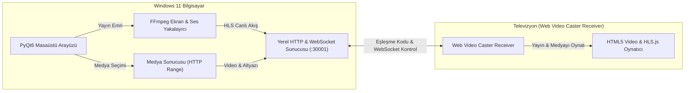

# 📺 Web Video Caster - Windows 11 Ekran ve Medya Yansıtıcı (Caster)

> **Web Video Caster Receiver** (Android TV, Google TV, Fire TV, LG webOS, Samsung Tizen) uygulamasına kendini uyumlu bir kaynak cihaz olarak tanıtarak **bilgisayarınızın ekranını (sesiyle birlikte) televizyona yansıtan** ve seçtiğiniz **yerel video/müzik dosyalarını altyazısıyla birlikte televizyonda oynatan** modern bir Windows 11 masaüstü uygulamasıdır.

---

## 🚀 Özellikler

- **🖥️ Canlı Ekran Yansıtma (Screen Mirroring):**
  - Windows masaüstünüzü donanım hızlandırma (NVIDIA NVENC, Intel QuickSync veya CPU) ile yakalar.
  - Düşük gecikmeli yerel HLS (HTTP Live Streaming) formatında televizyona aktarır.
  - 1080p, 720p, 2K ve 4K çözünürlük ile 30 FPS / 60 FPS seçenekleri.
- **🔊 Masaüstü Sistem Sesi (Audio Loopback):**
  - Ekranı yansıtırken bilgisayarınızda çalan tüm sistem seslerini televizyon hoparlörlerine senkronize iletir.
- **🎬 Yerel Medya Oynatıcı (Media Casting):**
  - Bilgisayarınızdan seçeceğiniz video (MP4, MKV, AVI, MOV, WEBM, TS) veya ses (MP3, FLAC, WAV, AAC) dosyalarını televizyonda oynatır.
  - **HTTP Range Requests (Kısmi İçerik):** Televizyonda videoyu ileri/geri sararken takılma yaşanmaz, dosyanın tamamı beklenmeden anında atlama yapılır.
  - **Otomatik Altyazı Desteği (.srt / .vtt):** Film veya diziyle aynı klasördeki `.srt` altyazıyı otomatik bulur, WebVTT formatına dönüştürüp televizyon ekranında gösterir.
- **🔗 Web Video Caster Base36 Protokol Uyumluluğu:**
  - TV'nizde Web Video Caster Receiver açıkken gösterilen 2-4 haneli eşleşme kodunu veya IP adresini tam olarak çözer.
  - Bilgisayarınız için özel üretilen eşleşme kodunu TV'ye yazarak **tek dokunuşla eşleşme** sağlar.
- **🌐 Çevrimdışı (Offline) Çalışabilme:**
  - TV alıcı arayüzü ve `hls.min.js` uygulama içine gömülüdür. İnternet kesilse dahi yerel Wi-Fi ağı üzerinden kesintisiz çalışır.
- **🎨 Windows 11 Fluent Dark UI:**
  - PyQt6 ile geliştirilmiş modern, göz yormayan karanlık tema, canlı log konsolu ve oynatıcı kontrolleri.

---

## 🛠️ Mimari ve Nasıl Çalışır?



1. **Eşleşme (Handshake):** Bilgisayarınız yerel ağda port `30001` üzerinde hafif bir HTTP & WebSocket sunucusu başlatır. Televizyonunuzdaki WVC Receiver uygulamasına bilgisayarın kodu (örneğin `9W`) girildiğinde TV, bilgisayarınızın web arayüzünü yükler.
2. **Ekran Yansıtma:** FFmpeg, Windows masaüstünü ve ses kartını yakalayarak 1'er saniyelik HLS parçalarına böler. TV oynatıcısı bu akışı neredeyse sıfır gecikmeyle oynatır.
3. **Medya Kontrolü:** Bilgisayar arayüzündeki Oynat, Duraklat, İleri/Geri Sar ve Ses kontrolleri WebSocket üzerinden TV'ye anında iletilir.

---

## 📦 Kurulum ve Çalıştırma (Windows 11)

### Yöntem 1: Kaynak Koddan Çalıştırma

1. **Python 3.10+ ve FFmpeg Gereklidir:**
   - [Python İndir](https://www.python.org/downloads/) (Kurulumda *"Add Python to PATH"* kutucuğunu işaretleyin).
   - [FFmpeg İndir](https://www.gyan.dev/ffmpeg/builds/) veya terminalden winget ile kurun:
     ```cmd
     winget install "Gyan.FFmpeg"
     ```

2. **Depoyu Klonlayın ve Klasöre Girin:**
   ```cmd
   git clone https://github.com/<KULLANICI_ADINIZ>/wvc-screen-caster-win.git
   cd wvc-screen-caster-win
   ```

3. **Gereksinimleri Yükleyin:**
   ```cmd
   python -m venv venv
   venv\Scripts\activate
   pip install -r requirements.txt
   ```

4. **Uygulamayı Başlatın:**
   ```cmd
   python main.py
   ```

---

### Yöntem 2: Tek Tıkla EXE Olarak Derleme (PyInstaller)

Proje klasöründeki `build_exe.bat` dosyasını çift tıklatarak çalıştırın.
İşlem tamamlandığında `dist\WVC_Caster\WVC_Caster.exe` konumunda bağımsız Windows uygulaması hazır olacaktır!

---

## 📺 Televizyona Bağlanma Adımları

1. Bilgisayarınızın ve Televizyonunuzun **aynı Wi-Fi / Yerel Ağa** bağlı olduğundan emin olun.
2. Televizyonunuzda **Web Video Caster Receiver** uygulamasını açın.
3. Bilgisayardaki uygulamanın üst kısmında büyük mavi kutuda görünen **Eşleşme Kodunu** (Örn: `9W`):
   - TV ekranındaki **"Enter Code" (Kod Gir)** seçeneğine yazıp **Connect** butonuna basın.
   - *Alternatif:* TV ekranında bir kod veya IP görünüyorsa, bilgisayardaki uygulamada *"TV'deki Kodu / IP'yi Girin"* kutusuna yazıp **"Bağlan"** butonuna basın.
4. TV ekranında *"Bilgisayar Bağlandı"* uyarısı göründüğünde eşleşme tamamlanmıştır!
5. Artık **"Ekran Yansıtmayı Başlat"** diyerek masaüstünüzü yansıtabilir veya **"Medya Yayını"** sekmesinden film/video seçip TV'de keyifle izleyebilirsiniz.

---

## 📄 Lisans

Bu proje [MIT Lisansı](LICENSE) ile lisanslanmıştır.
