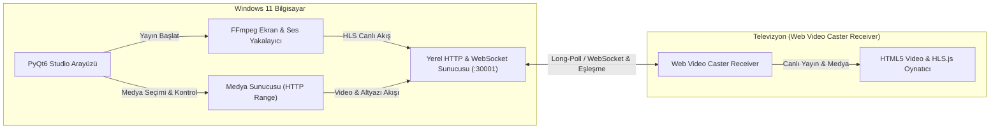

# 📺 Web Video Caster - Windows 11 Ekran ve Medya Yansıtıcı (Caster)

<p align="center">
  <b><a href="README.md">🇺🇸 English</a></b> | <b><a href="README.tr.md">🇹🇷 Türkçe</a></b>
</p>

> **Web Video Caster Receiver** (Android TV, Google TV, Fire TV, LG webOS, Samsung Tizen, Vestel/Vewd) uygulamasına kendini uyumlu bir kaynak cihaz olarak tanıtarak **bilgisayarınızın ekranını (sesiyle birlikte) televizyona yansıtan** ve seçtiğiniz **yerel video/müzik dosyalarını altyazısıyla birlikte televizyonda oynatan** modern bir Windows 11 masaüstü uygulamasıdır.

---

## 🚀 Temel Özellikler

- **🖥️ Canlı Ekran Yansıtma (Screen Mirroring):**
  - Windows masaüstünüzü donanım hızlandırma (**NVIDIA NVENC, Intel QuickSync, AMD AMF veya CPU libx264**) ile yakalar.
  - Düşük gecikmeli yerel HLS (HTTP Live Streaming) formatında televizyona aktarır.
  - 1080p, 720p, 2K ve 4K çözünürlük; 30 FPS, 60 FPS veya 24 FPS modları.
- **🔊 Masaüstü Sistem Sesi (Audio Loopback):**
  - Ekranı yansıtırken bilgisayarınızda çalan tüm sistem seslerini televizyon hoparlörlerine senkronize iletir.
- **🎬 Yerel Medya Oynatıcı (Media Player & Caster):**
  - Bilgisayarınızdan seçeceğiniz video (`.mp4`, `.mkv`, `.avi`, `.mov`, `.webm`, `.ts`) veya ses (`.mp3`, `.flac`, `.wav`, `.aac`) dosyalarını televizyonda kayıpsız kalitede oynatır.
  - **Tıklanabilir İlerleme Çubuğu & Anlık Atlama:** Zaman çizelgesine tek tıkla istenen dakikaya atlama ve 10 saniye ileri/geri (`⏪ -10s`, `⏩ +10s`) butonları.
  - **HTTP Range Requests (Kısmi İçerik):** Televizyonda videoyu ileri/geri sararken takılma yaşanmaz, dosyanın tamamı beklenmeden anında atlama yapılır.
  - **Otomatik Altyazı Desteği (.srt / .vtt):** Film veya diziyle aynı klasördeki `.srt` altyazıyı otomatik bulur, WebVTT formatına dönüştürüp televizyon ekranında senkronize gösterir.
- **🔗 Web Video Caster Protokol Uyumluluğu:**
  - Akıllı TV'lerdeki Web Video Caster uygulamasının yerel Long-Polling (`/web-receiver-io/*`) ve WebSocket (`/ws`) protokollerini tam destekler.
  - Bilgisayarınız için özel üretilen eşleşme kodunu TV'ye yazarak **tek tıkla anında eşleşme** sağlar.
- **🌐 Çift Dil Desteği (TR / EN):**
  - Arayüzün sağ üst köşesindeki tek bir buton ile Türkçe ve İngilizce arasında anında geçiş yapabilirsiniz.
- **🎨 Windows 11 Studio Dark UI:**
  - Modern, penceresiz (`pythonw.exe`) ve konsol kirliliği içermeyen temiz Fluent Studio Dark teması.

---

## 🛠️ Mimari ve Nasıl Çalışır?



---

## 📦 Kurulum ve Çalıştırma

### Yöntem 1: Kaynak Koddan Çalıştırma

1. **Python 3.10+ ve FFmpeg:**
   - [Python İndir](https://www.python.org/downloads/) (*"Add Python to PATH"* seçeneğini işaretleyin).
   - [FFmpeg İndir](https://www.gyan.dev/ffmpeg/builds/) veya PowerShell'den:
     ```powershell
     winget install "Gyan.FFmpeg"
     ```

2. **Depoyu Klonlayın:**
   ```powershell
   git clone https://github.com/erennnys/wvc-screen-caster-win.git
   cd wvc-screen-caster-win
   ```

3. **Gereksinimleri Kurun:**
   ```powershell
   py -m pip install -r requirements.txt
   ```

4. **Uygulamayı Başlatın:**
   ```powershell
   py main.py
   ```
   *(Arka planda konsol penceresi olmadan açmak için `pyw main.py` komutunu veya masaüstü kısayolunu kullanabilirsiniz.)*

---

### Yöntem 2: Tek Tıkla EXE Derleme (PyInstaller)

Proje dizinindeki `build_exe.bat` dosyasını çalıştırarak `dist/WVC_Caster/WVC_Caster.exe` konumunda tek parça çalıştırılabilir dosya elde edebilirsiniz.

---

## 📺 Televizyona Bağlanma

1. Bilgisayarınız ve Televizyonunuzun **aynı yerel ağda (Wi-Fi veya Ethernet)** olduğundan emin olun.
2. TV'nizde **Web Video Caster Receiver** uygulamasını açın.
3. Uygulamanın üst kartındaki **Eşleşme Kodunu** (Örn: `7U`):
   - TV ekranındaki **Kod Gir (Enter Code)** seçeneğine yazıp bağlanın.
   - *Alternatif:* TV ekranında görünen IP adresini bilgisayardaki manuel bağlantı çubuğuna yazıp **Bağlan** butonuna basın.
4. Eşleşme sağlandığında durum göstergesi yeşile döner. **Ekran Yansıtma** veya **Medya Oynatıcı** sekmesinden yayını başlatabilirsiniz.

---

## 📄 Lisans

Bu proje [MIT Lisansı](LICENSE) kapsamında geliştirilmiştir.
